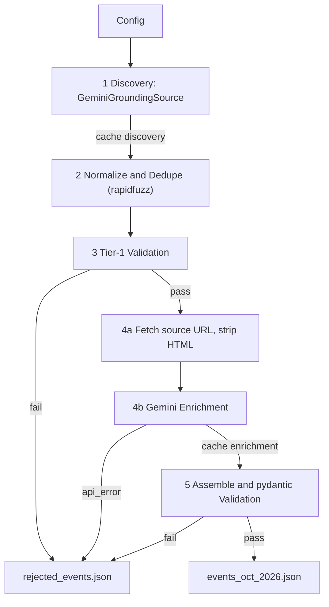

# Munich Events Pipeline (from DECISIONS.md)

The workspace currently holds only [DECISIONS.md](DECISIONS.md) and `task_requirment/`, so this is a greenfield build in the workspace root, following Decision #7's layout.

## Small inconsistencies to resolve during the build

- **ID generation:** Decision #4 says `uuid4`, while Decision #8 says deterministic `uuid5`. Use `uuid5(NAMESPACE, normalize(name) + date.start + city)`, generated right after dedupe (stage 2), because the enrichment cache key `enrich_{event_id}_{prompt_version}` needs an ID that stays the same across re-runs. Update DECISIONS.md to match.
- **Model:** `gemini-1.5-flash` has been retired. Make the model configurable (`GEMINI_MODEL`, default `gemini-2.5-flash`), use the `google-genai` SDK, and record the actual model in `meta.model`.
- **Grounding URLs:** Gemini grounding returns `vertexaisearch...` redirect links. Resolve them with an HTTP HEAD/GET that follows redirects, so `sources[].url` holds the real page URL. If resolution fails, keep the redirect URL and set `type: search_grounding`.
- **Grounding with structured output:** grounded calls can't reliably use `response_schema`. For discovery, ask for a JSON array in the response text and parse it leniently by stripping code fences. For enrichment (no grounding), use `response_schema` with the pydantic models.

## Architecture

## Files and responsibilities

- [src/config.py](src/config.py): a `Config` dataclass (`city`, `country`, `month`, `max_events`, `use_cache`, `output_path`, `prompt_version`, `prompt_dir`, `model`), filled from `.env` (via `python-dotenv`) and argparse flags (`--city`, `--month`, `--max-events`, `--no-cache`, `--output`, `--prompt-version`, `--verbose`). The default output path is `events_{city}_{month}.json`.
- [src/models.py](src/models.py): pydantic v2 models that mirror the consolidated schema:
  - Enums for `category`, `professional_level`, `group_types`, `gender_skew`, `source.type`, `stage`, and `reason`.
  - Validators that check the shares sum to about 1.0 (within 0.05) or are all null, and that `age_range.min <= max`.
  - `RawEvent` (discovery output), `EnrichmentResult` (Gemini schema), `Event`, `EventsFile`, `RejectedEvent`, `RejectedFile`.
- [src/cache.py](src/cache.py): JSON `get`/`set` under `cache/discovery/` and `cache/enrichment/`. It respects `use_cache`: when false, it skips the read but still writes.
- [src/prompts.py](src/prompts.py): loads `prompts/{version}/{name}.txt` and fills placeholders with `str.format`.
- [prompts/v1/discovery.txt](prompts/v1/discovery.txt) and [prompts/v1/enrichment.txt](prompts/v1/enrichment.txt): first-draft prompts. Both include the explicit rule "return unknown/null/[] rather than guess", the allowed values for each controlled field, and a request for evidence URLs in discovery.
- [src/sources/base.py](src/sources/base.py): an `EventSource` Protocol with `search(city, month) -> list[RawEvent]`. This file is a small addition to Decision #7's layout.
- [src/sources/gemini_grounding.py](src/sources/gemini_grounding.py): makes a grounded call with the `google_search` tool, wrapped in `tenacity` (3 attempts, exponential backoff, then abort). It merges the event URLs from the response text with the grounding-metadata chunks, resolves redirects, and caches the result under `discovery_{city}_{month}`.
- [src/fetch.py](src/fetch.py): uses `httpx` with a timeout and browser user agent, extracts text with `BeautifulSoup`, and truncates to about 8k characters to limit token cost. It returns `None` on failure, and the event is then enriched from name, date, and venue only, with lower confidence.
- [src/dedupe.py](src/dedupe.py): `normalize()` lowercases the name and strips the year and punctuation. Two events match when `token_set_ratio >= 85` and their date ranges overlap. Matches are merged: sources are combined (deduped by URL), the longest name is kept, and the record with a date and the more detailed venue is kept.
- [src/enrichment.py](src/enrichment.py): one Gemini call per event with `response_schema=EnrichmentResult`, cached as `enrich_{id}_{version}`. There are no retries; an exception becomes `api_error`.
- [src/pipeline.py](src/pipeline.py): runs stages 1–6 in order and stamps `retrieved_at`, `rejected_at`, and `generated_at`. It computes `data_quality`:
  - `fields_unknown` and `fields_estimated` are derived in code from null or `unknown` values.
  - Confidence starts from the model's self-rating, then gets penalties for each unknown field and for a failed fetch.
  - It uses the logging lines from Decision #9 (`[i/N] Enriching: X (cache hit | calling Gemini | failed, dropped)`) and can be run with `python -m src.pipeline`.
- Repo files:
  - `requirements.txt`: `google-genai`, `pydantic`, `python-dotenv`, `httpx`, `beautifulsoup4`, `rapidfuzz`, `tenacity`.
  - `.env.example` with `GEMINI_API_KEY`, `GEMINI_MODEL`, `PROMPT_VERSION`, and `PROMPT_DIR`.
  - `.gitignore` covering `.env`, `cache/`, `task_requirment/`, `__pycache__/`, and `.venv/`.

## Cost guardrails

- The whole run is 1 discovery call plus up to `max_events` enrichment calls, which comes to cents on Flash. Develop with `max_events=3`, then do the final run at 15.
- Every paid call goes through the cache, so tuning dedupe, validation, and assembly logic is free.

## Final run and delivery

- Run: `python -m src.pipeline --output events_oct_2026.json --max-events 15`. Then check the output by hand: real URLs, dates within October 2026, and shares that sum to 1.
- README covers:
  - Setup and run steps.
  - The schema and field tiers.
  - A clear statement that audience and origin figures are modeled estimates.
  - The data-sourcing trade-off, cost controls, and limitations, including grounding recall and no over-fetching.
  - Phase 2 adapters as future work.
- Before pushing, run `git init` and confirm that `task_requirment/`, `.env`, and any key string are absent from tracked files, for example with `git grep` for the key prefix. Then push to a public GitHub repo with `gh repo create`.
